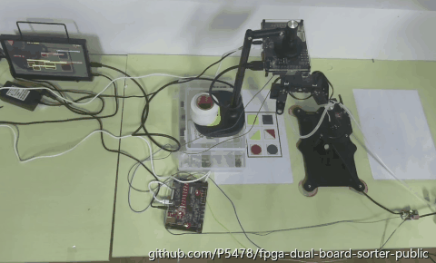
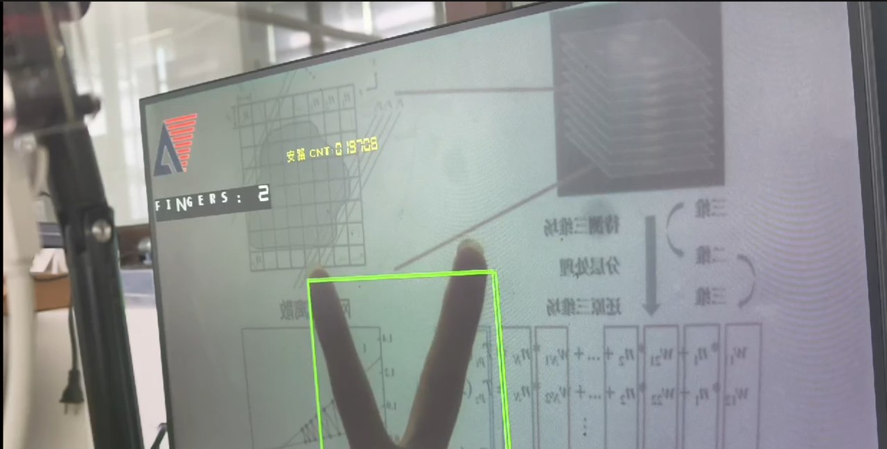
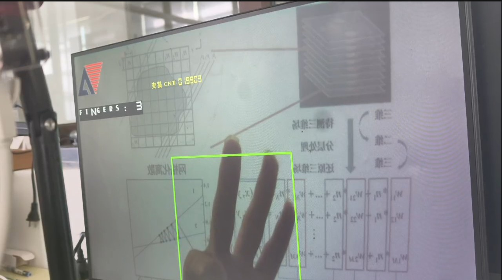
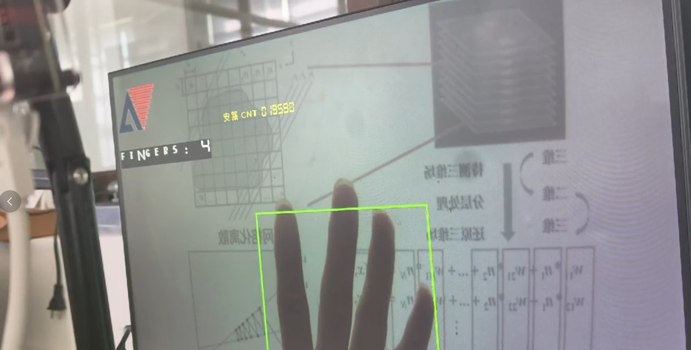
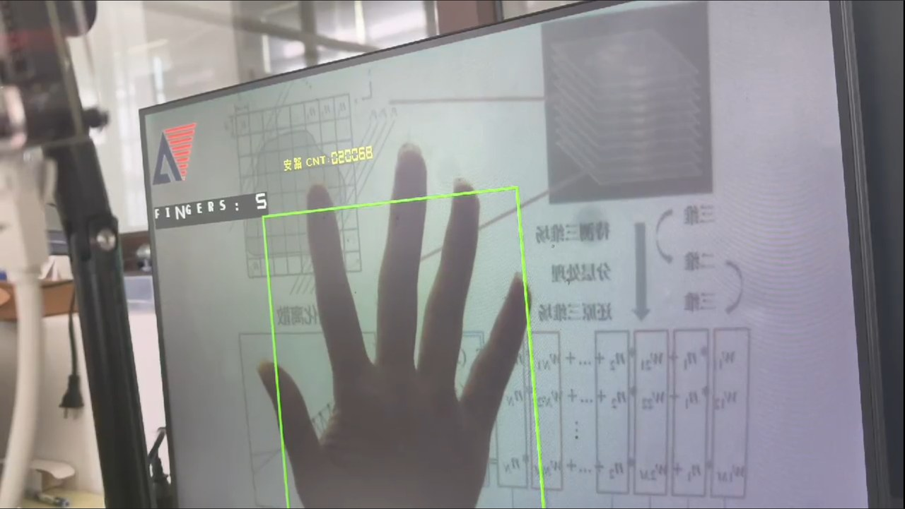
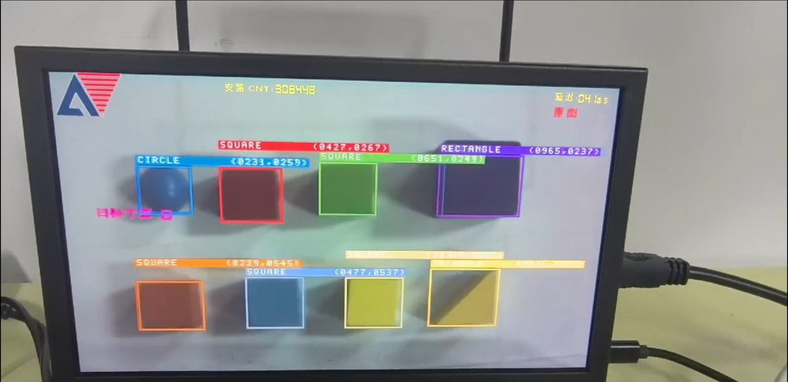
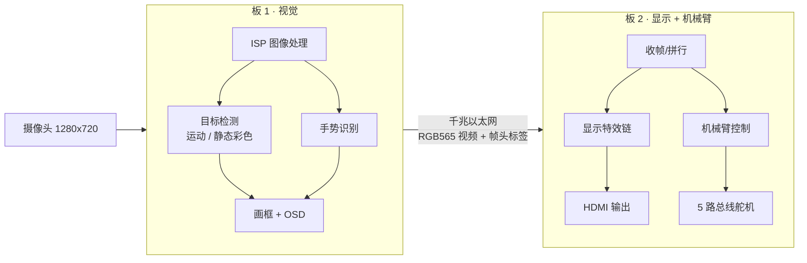

# 双 FPGA 实时视觉分拣系统

> 两块 FPGA、一条千兆网线、一只五轴机械臂：
> 从"看见"到"动手"，整条链路全部在硬件里完成，没有电脑、没有操作系统、没有云端。

---

## 一分钟看懂

想象一条小小的流水线：

1. **板 1 是"眼睛"** —— 摄像头每秒拍 60 张照片，板 1 在每一帧画面上实时找出桌子上的彩色积木，
   认出每块积木是**什么颜色、什么形状**，还顺便数出画面里伸出手指的是**几根手指**。
2. **中间是一根网线** —— 板 1 把**画好框的画面**压成视频流，通过千兆以太网发给板 2。
   有意思的是，识别结果（哪一格有什么颜色的什么形状）就藏在每一帧的**帧头**里，跟着画面一起走，不额外占带宽。
3. **板 2 是"手和脸"** —— 它一边把收到的画面做实时特效后送到 HDMI 显示器，
   一边把帧头里的 6 格标签交给机械臂：**按颜色分** 还是 **按形状分**，由你按键决定。

按一下启动键，机械臂就会自己跑完"回位 → 靠近 → 吸取 → 抬起 → 转向 → 放下 → 复位"的完整动作，
把积木从左边格子搬到右边对应落点。整个过程约 25 秒一件，中间不需要电脑参与。

**这套东西完全是硬件电路实现的**：识别、显示、动作序列都由 FPGA 内部的逻辑电路并行执行，
不是在一块芯片上跑程序。这也是它能做到"画面进来就有结果"的原因。

---

## 效果预览

**机械臂自动分拣**（1.5 倍速）：从左边的取件区吸取积木，转向后放到右边的落点。
左边小屏是板 1 传过来的实时识别画面。



**实时手势识别**：`FINGERS: N` 和手部外框由 FPGA 在像素流水线上实时算出，
全程不经过 CPU。

| 2 根手指 | 3 根手指 | 4 根手指 | 5 根手指 |
|---|---|---|---|
|  |  |  |  |

**静态彩色多目标识别**：每个目标都实时给出颜色/形状标签（CIRCLE / SQUARE /
RECTANGLE）和中心坐标，外框颜色对应识别到的颜色；右上角实时显示处理延迟
（图中为 4 ms）。



---

## 系统长什么样



| 部分 | 型号/规格 | 职责 |
|---|---|---|
| 主控 × 2 | 安路 PH1P35（PH1P35MDG324） | 双板分工，各自独立工作 |
| 摄像头 | SC500CS（MIPI，1280×720） | 采集画面 |
| 链路 | 千兆以太网（RGMII） | 板 1 → 板 2 单向视频流 |
| 机械臂 | 5 个总线舵机（吸盘式） | 吸取、搬运、放置 |
| 显示 | HDMI 1280×720 | 实时画面 + 特效 |

---

## 完整工作流程

按时间顺序，一次分拣是这样发生的：

### ① 采集
摄像头通过 MIPI 接口把画面送进板 1。板 1 先做图像处理（ISP）：
把传感器原始的 RAW 数据变成正常颜色、正常亮度的画面，并自动调节曝光和白平衡，保证不同光照下都能用。

### ② 识别（每帧都做，全硬件流水线）
板 1 上同时跑着两套识别：

- **运动目标检测**：把当前帧和上一帧对比，找出"动过"的区域——人走过、积木被推动都能看到，
  画面上会出现跟随目标的框。
- **静态彩色多目标识别**：按照颜色和形状，把桌子上的积木一块块找出来（最多同时 8 块），
  每块输出中心坐标、外框、颜色码和形状码。

同时还有一路**手势识别**：根据手部区域的形状，数出伸出了几根手指（1~5），并画出手的外框。

### ③ 目标 → 格子
桌子被划分成 **3 列 × 2 行 = 6 个格子**（左边是取件区 L1~L6）。
板 1 根据每块积木的中心坐标判断它落在哪个格子，把结果整理成"6 格标签"：

```
每个格子一个字节 = {2 位保留, 3 位形状, 3 位颜色}
颜色：红 橙 黄 绿 青 蓝 紫
形状：圆 三角 方 长方
```

连续 10 帧结果一致才更新标签（约 0.17 秒），避免画面抖动导致机械臂拿错格。

### ④ 上屏 + 上网
画好检测框、手势框和数字的画面，被拆成一行一行打包成自定义以太网帧；
每帧 16 字节帧头里除了帧号/行号，还塞进了 **6 格标签** 和一些状态数字（延迟、目标数）。
一帧画面 = 720 行 × 2 段 = 1440 个以太网帧，每秒发 30 帧画面。

### ⑤ 板 2 收帧显示
板 2 从网口把一段段像素收回来，拼成完整画面，经过特效链处理后由 HDMI 输出。
帧头里的数字被叠加到屏幕上；帧头里的 6 格标签被重新拼成 8 字节帧，喂给机械臂。

### ⑥ 机械臂分拣
按一下板 2 的启动键，机械臂开始工作：

- **按颜色分**：红色 → R2 落点，黄色 → R4，蓝色 → R6，其它颜色不搬；
- **按形状分**：三角形 → R2，方形 → R4，圆形 → R6，其它形状不搬。

每搬一件是一趟 **20 步动作序列**：回到初始位 → 移到目标格上方 → 下压吸取 →
抬到搬运高度 → 转向 → 移到 R 落点 → 放下 → 复位。每发一条舵机指令都会回读位置做校验。

### ⑦ 循环
搬完一遍后，板 1 会重新判断哪些格子还有东西。如果还有遗漏，可以选择再跑一趟。

---

## 核心功能清单

| 功能 | 说明 |
|---|---|
| 实时运动检测 | 帧差法，分块统计 + 形态滤波，画面里动的东西都会被框出来 |
| 静态彩色识别 | 颜色/形状双维度分类，最多同时识别 8 个目标 |
| 手势识别 | 数手指 1~5，输出手部外框，全部在像素流水线里完成 |
| 双板视频链路 | 千兆以太网传 1280×720@30fps，占用约 45% 带宽 |
| 自定义帧协议 | 16 字节帧头 + RGB565 像素分块，带帧号/行号校验，掉段可检测 |
| 显示特效链 | 19 档实时特效（含四宫格快照），按键循环切换 |
| 双模式分拣 | 按颜色 / 按形状，按键切换，数码管同步显示当前模式 |
| 落点巡航 | 拨码触发，自动走访 L 区或 R 区的 6 个落点，用于标定和检查 |
| 手动标定 | 舵机泄力 + 实时位置回读，方便现场校准 |
| 调试体系 | 串口状态行、舵机指令原文监视、数码管状态指示 |

---

## 技术亮点

如果你想知道"这项目难在哪"，可以从这几个角度看：

1. **整条视觉链路是纯硬件流水线**
   从摄像头进来到识别结果出来，中间没有任何一帧被存到内存里"事后处理"。
   像素边流过边计算，延迟只有几十毫秒。这是 FPGA 相比 CPU/GPU 方案的核心优势，也是本项目最难的部分。

2. **双板分工会遇到真实的跨时钟域问题**
   摄像头 75MHz、网口 125MHz、系统 50MHz——不同时钟域之间的数据传输必须做同步。
   项目里用了异步 FIFO、双缓冲、握手信号等多种手段，保证画面不撕裂、不丢行。

3. **通信协议是自己设计的**
   视频不是用现成的 UDP 协议栈，而是在 MAC 层直接打包：帧头带帧号/行号/段号，接收端可以检测断帧、丢段；
   识别结果（6 格标签）复用帧头传输，等于"免费"带了一条数据通道。

4. **从"看到"到"动手"的完整闭环**
   很多视觉项目只做到识别为止。这里识别结果直接驱动机械臂完成物理动作，
   中间还要处理防抖、格子映射、动作时序、舵机回读校验等工程问题。

5. **现场可标定、可调试**
   格子位置、落点高度都可以现场调整；按键/拨码设计了巡航和泄力标定模式；
   串口能同时看到帧统计、机械臂状态和舵机指令原文。

---

## 性能指标

| 指标 | 数值 |
|---|---|
| 摄像头分辨率 | 1280 × 720 |
| 链路帧率 | 30 fps（相机 60 fps，隔帧发送） |
| 以太网带宽占用 | 约 448 Mbit/s（千兆链路的 45%） |
| 识别目标数 | 最多 8 个/帧 |
| 格子划分 | 3 列 × 2 行 = 6 格 |
| 标签去抖 | 连续 10 帧一致（约 167 ms） |
| 手势识别 | 1~5 根手指 |
| 显示特效 | 19 档 + 四宫格快照 |
| 机械臂自由度 | 5 路总线舵机 |
| 单件分拣节拍 | 约 20~26 秒（取决于落点） |

---

## 仓库内容说明

这是一个**公开预览版**，用于展示项目架构与工程组织方式：

```
├── README.md            本文件
├── docs/                深入介绍（架构 / 链路 / 识别 / 机械臂 / 操作 / 指标）
├── src_preview/
│   ├── board1/          板 1 核心模块的【接口骨架】
│   ├── board2/          板 2 核心模块的【接口骨架】
│   └── common/          少量可独立阅读的通用模块（完整实现）
├── assets/              实拍效果图（分拣动作 GIF / 手势识别 / 目标识别）
└── LICENSE              版权声明（重要，请先阅读）
```

**骨架模块**保留了完整的端口定义和中文设计说明，可以清楚看到每个模块的职责、
接口划分和模块之间的协作关系；但**具体实现不包含在本仓库中**。
`common/` 下的通用模块（按键消抖、UART 发送、同步器）是完整可读的示例代码，
用于展示本项目的代码风格。

---

## 关于代码完整性（重要）

本项目的检测算法、手势识别模型、格子标定参数、机械臂动作表等内容属于核心技术资产，
**没有包含在公开仓库中**（它们位于作者的私有仓库里）。

这不是"藏私"，而是正常的工程保护：这些参数和算法是经过大量现场调试才定下来的，
它们决定了系统在真实环境里能不能稳定工作。仅凭本仓库的接口说明，无法复刻出可用的系统。

**如果你对某个技术细节感兴趣**，比如跨时钟域怎么处理、帧协议怎么设计、
机械臂动作序列怎么规划，欢迎通过 Issues 交流讨论。

---

## 版权与使用限制

本项目代码及文档版权归作者所有，**保留所有权利**。
未经书面许可，禁止复制、修改、分发本项目内容，禁止用于商业用途，禁止基于本仓库内容复刻同类系统。
详见 [LICENSE](LICENSE)。

---

## 交流

- 问题与讨论：GitHub Issues
- 如果你是招聘方/老师，希望了解完整实现或现场演示，可以通过 GitHub 联系作者。
