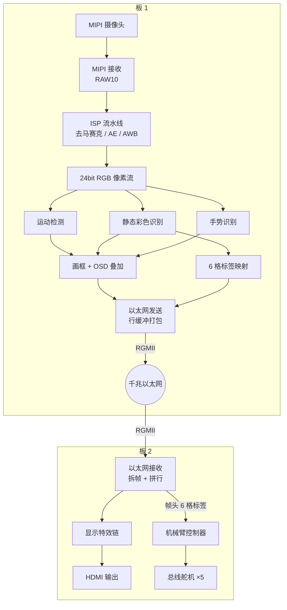

# 01 · 系统架构详解

## 1. 为什么用两块 FPGA

把"摄像头采集 + 图像识别 + 视频显示 + 机械臂控制"塞进一块 FPGA 不是不行，
但会带来三个实际问题：

1. **资源与时序压力**：1280×720 的实时处理需要大量行缓存和运算单元，
   显示链路又要自己的时钟域和缓冲，一块芯片上同时跑容易把时序逼到极限。
2. **采集与显示互相干扰**：板 1 如果直接从显示链路取画面发给板 2，
   就会形成"采集 → 显示 → 再采集"的闭环，画面会越迭代越糊。**必须从传感器源头取画面**。
3. **职责不清**：视觉算法调试、显示特效调试、机械臂动作调试是三条完全不同的工作线，
   放在一块板子上，任何一处改动都可能影响其它部分。

所以采用双板分工：

- **板 1：只管"看"** —— 接摄像头，做 ISP 和识别，把结果画进画面，打包上网。
- **板 2：只管"显 + 动"** —— 收画面、做特效、输出 HDMI，同时驱动机械臂。

两块板之间只有一条单向的千兆以太网链路（板 1 → 板 2），
数据流是"水往低处流"，不会回流，消除了闭环干扰。

## 2. 顶层框图

## 3. 数据通道一览

系统里其实有三条"数据通道"：

| 通道 | 内容 | 带宽 | 用途 |
|---|---|---|---|
| 视频通道 | RGB565 像素 + 16 字节帧头 | 约 448 Mbit/s | 板 1 → 板 2 画面 |
| 标签通道 | 6 格标签（藏在帧头里） | 约 0.6% 帧头开销 | 识别结果 → 机械臂 |
| 调试通道 | 状态行 / 舵机指令原文 | 115200 串口 | 开发与排障 |

**设计上的一个巧思**：标签通道复用视频通道的帧头。每帧画面有 1440 个以太网帧，
每个都带着同样的 8 字节标签，接收端只取每帧第一段的那一份。
这样既省掉了板间的一根通信线，又天然获得了"每帧刷新一次"的同步性。

## 4. 时钟域划分

| 时钟域 | 频率 | 负责 |
|---|---|---|
| 像素域（板 1） | 75 MHz | ISP 输出、检测、画框、行缓冲写入 |
| MAC 域（板 1 / 板 2） | 125 MHz | 以太网帧收发 |
| 系统域（板 2） | 50 MHz | 机械臂状态机、按键消抖、显示控制 |

跨时钟域的处理方式：

- **像素数据**：用异步 FIFO / 双缓冲，写侧像素时钟、读侧 MAC 时钟；
- **单比特事件**（如"新的一帧标签到了"）：用两级同步器 + 翻转握手；
- **多字节数据**（如 8 字节标签）：数据先稳定一整帧，再用翻转信号通知对方采样，
  保证采样时数据不会正在变化。

## 5. 模块职责划分

### 板 1

| 模块 | 职责 |
|---|---|
| `design_top_wrapper` | 顶层：连接所有模块，处理按键和数码管 |
| `frame_diff_bbox` | 运动检测 + 静态彩色识别，输出最多 8 路目标 |
| `gesture_recognizer` | 手势识别（手指数量 + 手部外框） |
| `hand_box_draw` | 把手部框画进视频流 |
| `cell_map_uart` | 目标 → 6 格映射，输出标签帧 |
| `eth_rgb_line_send` | 行缓冲打包，生成以太网帧 |

### 板 2

| 模块 | 职责 |
|---|---|
| `design_top_wrapper` | 顶层：显示链路 + 机械臂 + 按键 |
| `eth_rgb_recv` | 收帧、拆头、拼行，还原像素流 |
| `eth_rgb_effect_chain` | 显示特效处理 |
| `sort_arm_top` | 机械臂顶层：解析标签、分拣策略、按键处理 |
| `seq_ctrl` | 20 步动作序列控制器 |
| `sort_rule` | 分拣策略（颜色/形状 → 落点） |
| `arm_table` | 落点查表 |

## 6. 设计取舍记录

- **为什么 RGB565 而不是 YUV422**：两者带宽相同，但下游特效按 RGB 三通道设计，
  用 RGB565 可以直接复用，不用改特效模块。
- **为什么隔帧发送（30fps 而不是 60fps）**：60fps 需要约 91% 的千兆带宽，
  而 MAC 没有流控，容易丢帧；30fps 只占 45%，留足余量。
- **为什么识别结果只送 6 格标签而不是原始坐标**：机械臂只关心"哪一格有什么"，
  压缩成格子标签后，每帧只需 6 个字节，且天然完成了坐标量化，减少抖动。
