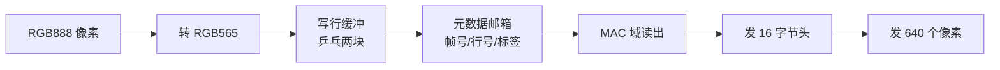

# 03 · 以太网视频链路

> 这是整个项目最"工程"的部分：如何把 1280×720 的画面稳定地送过一根网线，
> 还要顺便把识别结果捎过去。

## 1. 为什么自己设计帧格式

常见的做法是用 UDP + 现成协议栈，但在这个项目里不合适：

- 协议栈会带来额外的缓冲和延迟，而且资源开销大；
- 我们需要"每行两段"的细粒度切分，方便接收端用双缓冲拼行；
- 识别结果需要和视频帧严格同步——每帧发一次标签最自然。

所以直接在 MAC 层之上定义了一套**轻量帧格式**：

```
每个以太网帧 = 16 字节帧头 + 640 个 RGB565 像素（1280 字节）
总长 1296 字节
```

## 2. 一帧画面怎么拆

```
一行 1280 像素
├── 段 0：像素 0..639    → 以太网帧 #1
└── 段 1：像素 640..1279 → 以太网帧 #2

720 行 × 2 段 = 1440 个以太网帧 = 1 帧画面
```

帧头里携带：

| 字段 | 作用 |
|---|---|
| 帧号 | 区分不同画面 |
| 行号 | 0..719 |
| 段号 | 0/1 |
| 状态数字 | 处理延迟、目标数量、手势结果 |
| 6 格标签 | 识别结果（每格 1 字节） |

## 3. 带宽账

| 项目 | 数值 |
|---|---|
| 每帧字节 | 1296 B |
| 每画面帧数 | 1440 |
| 每画面字节 | 1.87 MB |
| 30 fps 时 | 56 MB/s ≈ 448 Mbit/s |
| 千兆链路占用 | 约 45% |

留出 55% 余量是刻意的：MAC 没有流控，突发时如果占满带宽，丢帧会直接变成画面撕裂。

## 4. 发送端流水线（板 1）



关键设计：

1. **整行先落缓冲，再从 MAC 域读出**。
   早期版本用"边收边发"的流式拼装，结果段首的帧头经常丢——因为 FIFO 的
   预取时序和帧头耦合在一起。改成行缓冲后，帧头由 MAC 域自己产生，永远在段首。
2. **邮箱机制**：像素域写完一行，把 {帧号, 行号, 标签, 缓冲块号} 放进两级邮箱，
   MAC 域通过翻转信号取走。这样两个时钟域互不阻塞。
3. **段间必须留空拍**：两个段是两个独立以太网帧，MAC 需要时间收尾，
   否则第二段的头会被当成上一帧的尾巴。

## 5. 接收端流水线（板 2）


关键设计：

1. **帧号 + 行号双重校验**：只有"帧号变化 且 行号=0"才算新帧开始，
   防止断流造成的假帧起始。
2. **双缓冲乒乓**：正在拼的行和正在收的行不能共用一块缓冲，
   否则下一段到了会把上一行覆盖。
3. **时间预算**：一行 2592 字节在 125MHz 下 20.7 µs 到达，
   拼一行需要约 12.2 µs，来得及；如果来不及，模块里有一个 `drop` 标志会记录下来。
4. **帧首斩断**：新帧确认时，立刻掐掉正在拼的上一帧最后一行，
   避免滚动条/残影这类"跨帧污染"。

## 6. 标签通道

6 格标签（每格 = 形状码 + 颜色码）被打包成 8 字节：

```
'L' | b1 | b2 | b3 | b4 | b5 | b6 | '!'
```

- 每个视频帧的每个以太网帧都重复携带这 8 字节；
- 接收端只在"行 0、段 0"那一刻锁存，每帧取一次；
- 锁存后通过翻转信号同步到 50MHz 域，再逐字节重放给机械臂解析器。

机械臂侧完全不知道这些字节来自以太网——它看到的和串口收到的字节流一模一样，
所以协议解析代码可以原样复用。

## 7. 调试经验（踩过的坑）

- **段首丢头**：流式拼装不可靠 → 改成行缓冲。
- **画面横向错位**：跨时钟 FIFO 复位时机不对，导致每行多流进几个字
  → 帧首确认时立刻斩断当前行。
- **显示器画面"定格"**：早期从 HDMI 输出取画面，形成显示→采集闭环
  → 改从 ISP 输出取画面。
- **帧率不稳**：相机 60fps 直接上线会把千兆链路打满 → 隔帧发送。
