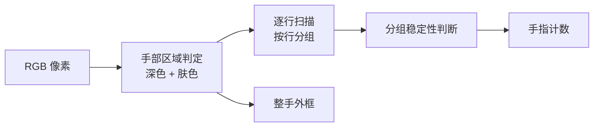

# 04 · 视觉识别系统

板 1 的视觉系统包含四部分：ISP 图像处理、运动目标检测、静态彩色识别、手势识别。

## 1. ISP：先把画面变"正常"

摄像头传感器输出的是 RAW 数据（每个像素只有一种颜色的亮度），
需要经过 ISP 流水线才能变成人眼熟悉的画面：

```
RAW10 → 去马赛克 → RGB888 → 自动白平衡 → 自动曝光
```

- **去马赛克**：每个像素缺失的两个颜色分量由周围像素插值得到（3×3 窗口）。
- **自动白平衡**：让白色物体在不同光源下都显示为白色。
- **自动曝光**：根据画面亮度自动调整传感器曝光，暗光环境自动提高增益。

这一部分在像素时钟域流水线完成，不占 CPU，也没有帧缓存。

## 2. 运动目标检测（帧差法）

原理很朴素：**上一帧和这一帧不一样的地方，就是动过的地方。**

实现上有几个工程细节：

1. **降采样**：按 4×4 块统计，减少计算量和噪声。
2. **分块统计**：块内平均灰度差超过阈值才算"有效差分"。
3. **3×3 多数滤波**：孤立噪点会被邻居投票淘汰——需要周围至少一定数量的
   "有效差分"块才会被保留，这样 OSD 文字、细小纹理不会误触发。
4. **行程判定**：只有连续足够多的块才构成目标，过滤远处的小噪点。
5. **框体跟踪**：目标框在上一个位置附近平滑移动，避免框体抖动。

最终输出：目标框的坐标、大小，并判断是否"在动"。

## 3. 静态彩色识别

静态目标没有帧差可用，必须靠颜色和形状：

```
像素颜色判定 → 连通块统计 → 目标外框 → 形状分类 → 颜色分类
```

- **颜色分类**：把像素和一组参照色做距离比较，归到最近的颜色类别
  （红、橙、黄、绿、青、蓝、紫 + 未知）。
- **形状分类**：根据外框内的填充率、边缘分布等几何特征，区分
  圆形 / 三角形 / 方形 / 长方形。
- **多目标**：最多同时跟踪 8 个目标，每个都有独立的标签和平滑处理。


*识别效果：每个目标给出颜色/形状标签与中心坐标，外框颜色对应目标颜色，
右上角显示处理延迟（图中 4 ms）*

> 具体阈值、判定树和滤波参数属于核心实现，不在公开仓库中。

## 4. 手势识别

目标：从画面里数出伸出了几根手指（1~5），并给出手部外框。

整体思路：



工程要点：

- **多判据融合**：不同光照下"手"的颜色差异很大，单一阈值不稳定，
  因此结合了亮度、色度、低照度补偿等多个条件。
- **逐行分析**：在扫描带内按行统计"手部像素"的连续段，
  每行的连续段对应一根手指或手掌的一部分。
- **行分组**：相邻行里位置接近的连续段归为同一组，
  一组就是一根竖直的手指；再结合手掌区域排除误判。
- **稳定性约束**：分组必须在连续多行里都存在，才算真的手指，
  防止噪点导致数量跳变。

手势结果通过 OSD 叠加到画面上，同时也会被放进以太网帧头，板 2 那边可以显示。


*手势识别效果：左上角实时显示 FINGERS: 5 与手部外框*

> 完整的阈值模型、扫描带宽和几何判定规则属于核心实现，不在公开仓库中。

## 5. 从目标到格子

识别模块输出的是"目标中心坐标"，而机械臂需要的是"哪一格有什么"。
中间的转换在 `cell_map_uart` 里完成：

```
目标中心 (x, y)
      ↓  用 3×2 网格做矩形范围判定
格号 L1..L6
      ↓  同格多目标按优先级取舍
每格一个标签字节 {保留, 形状, 颜色}
      ↓  连续 N 帧一致才更新
稳定标签
      ↓
UART 帧（'L' + 6 字节 + '!') + 以太网帧头副本
```

**为什么要去抖**：识别结果在阈值边缘会出现帧间跳变（比如圆/方来回跳），
而机械臂"只认最后一帧"，跳一次就可能搬错格。连续 10 帧一致才更新，
在 60fps 下只增加约 0.17 秒延迟，对 20 多秒一次的搬运完全可接受。

## 6. OSD 与调试

画面左上角叠加了若干调试信息：

- 处理延迟（毫秒）
- 当前目标数量
- 手势结果
- 检测模式

这些数字既方便现场调试，也通过帧头传给板 2，在显示端同步展示。
