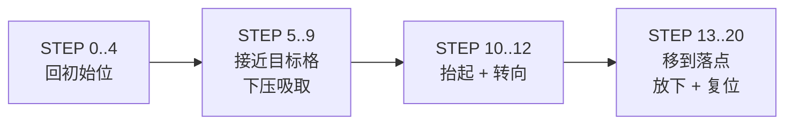

# 05 · 机械臂控制与分拣


*实际运行画面（1.5 倍速）：左侧小屏是板 1 的实时识别画面，机械臂完成一次吸取—搬运—放置*

## 1. 硬件组成

- **5 个串行总线舵机**：一条信号线级联，每个舵机有唯一 ID（#000~#004）。
- **吸盘末端**：气泵抽真空吸取积木，放下时泄压。
- **供电**：舵机独立供电，与 FPGA 共地。

总线舵机的指令模型很简单：

```
#ID P<目标位置> T<运行时间>!
```

意思是"ID 号舵机，在 T 毫秒内走到 P 位置"。控制器不需要闭环，
只要按顺序把指令发出去，舵机自己会完成动作并保持在目标位置。

## 2. 从"格子"到"动作"

板 2 收到的是 6 格标签：每一格有颜色和形状。分拣策略是一个纯组合逻辑：

```
如果 模式 = 按颜色：
    红 → R2   黄 → R4   蓝 → R6   其它 → 不搬
如果 模式 = 按形状：
    三角 → R2  方 → R4   圆 → R6   其它 → 不搬
```

策略做成独立模块（`sort_rule`），换规则不用动主流程。

## 3. 一次搬运的 20 步

一次完整搬运被拆成 20 个动作步骤，大致分成四段：



| 阶段 | 动作 | 说明 |
|---|---|---|
| 回初始位 | 大臂抬起、小臂收回、底座归位、腕部归中 | 保证每次从同一姿态出发 |
| 接近目标 | 底座摆到目标列、小臂伸出过头再退回、腕部摆动、垂直下压 | "过头再退回"可以消除机械间隙 |
| 抬起转向 | 垂直抬起、末端转向落点方向 | 抬起高度要避开桌面障碍 |
| 放置 | 底座摆到落点、小臂伸出、下压、泄压、复位 | 与吸取动作对称 |

**多轴联动**：同一组里没有空间冲突的舵机指令会连着发出去，
几个关节会同时开始运动，缩短整趟时间。有冲突的动作之间则要等上一步走完。

## 4. 时序与校验

每个动作步骤的执行流程：

```
发指令 → 等待（运行时间 + 余量）→ 回读位置 → 下一步
```

- **等待余量**：开环控制只能死等。余量太小，上一条指令还没走完，
  下一条就来了，舵机会丢命令；余量太大，整趟时间变长。
  最终值是在"看得出的快"和"不丢命令"之间权衡出来的。
- **回读校验**：每步之后回读舵机实际位置，和命令值对比。
  差几十是正常的负载误差，差几百说明那一步的命令丢了。
- **全局速度系数**：所有步骤的运行时间统一乘以一个系数，
  想整体调快调慢只改一个数。

## 5. 工作模式

机械臂模块支持几种工作方式：

| 模式 | 触发 | 行为 |
|---|---|---|
| 正常运行 | K2 启动 | 遍历 6 个格子，按策略搬走符合条件的目标 |
| 回初始位 | K1 复位/松开 | 只跑 STEP 0..4，回到初始姿态 |
| L 区巡航 | SW2 拨动 | 依次去 L1~L6，每格回初始位→压一下→抬起 |
| R 区巡航 | SW3 拨动 | 依次去 R1~R6，用于落点标定 |
| 手动标定 | SW4 拨动 | 舵机泄力，可手推动；串口周期回读所有舵机位置 |

巡航模式很实用：画格子、核对落点、检查机械臂有没有撞到东西，
都不需要真的跑一遍分拣。

## 6. 安全设计

- **位置限幅**：所有命令位置都在软件里限制在安全范围，不会发超出机械行程的值。
- **泄力模式**：舵机断电输出后可以自由推动，用于标定；
  退出时下一条位置指令会自动把扭矩接回来。
- **防止误启动**：启动键和外部按键并联，必须有一个明确的按下动作；
  运行中重复按键不会打断当前流程。
- **掉电恢复**：上电后自动回初始位，避免机械臂停在不可预期的位置。

## 7. 参数怎么来的

动作表里的每个位置和时间，都是现场标定出来的：

1. 用泄力模式把机械臂摆到目标姿态；
2. 从串口读出 5 个舵机的当前绝对位置；
3. 记录下来，填进动作表；
4. 用巡航模式逐个落点核对，确认没有偏差。

这些数值和动作表属于核心工程资产，**不在公开仓库中**。
