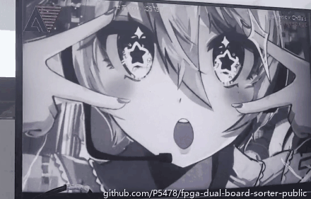
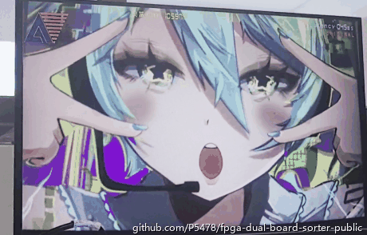
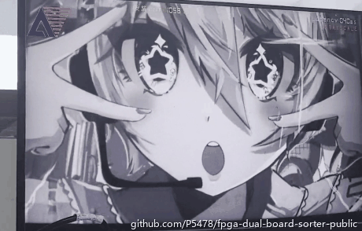
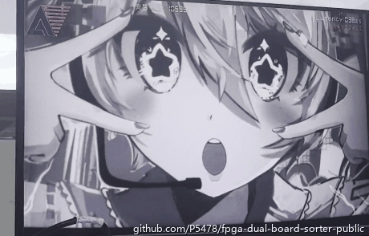
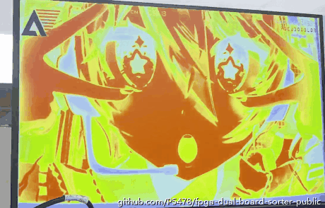
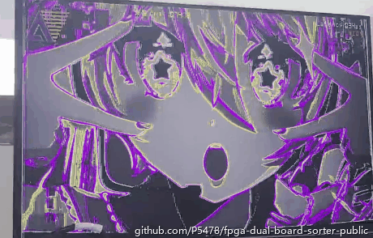
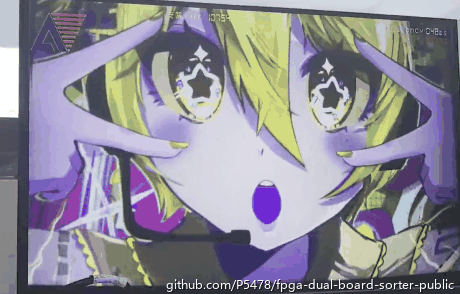
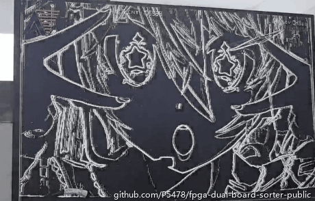
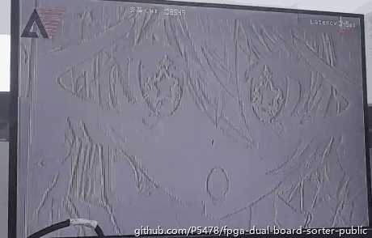
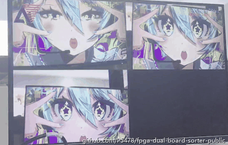

# 08 · 显示特效一览

板 2 的显示链路内置 19 档实时特效，按 K3 循环切换。
下面是从实拍视频里截取的 9 段（10 fps，片段名称按视觉特征命名，
实际档位编号以工程内为准）。

所有效果都在像素流水线上实时完成：画面从以太网进来，经过特效处理后直接送 HDMI，
不经过 CPU、不存帧。

## 快速巡览

*灰度 → 高对比黑白 → 金色调 → 边缘线稿（3 倍速剪接）*

## 原图与基础调色

| 原图（无处理） | 灰度 | 高对比黑白 |
|---|---|---|
|  |  |  |

## 风格化

| 金色调 | 紫色调 | 怀旧黄调 |
|---|---|---|
|  |  |  |

## 边缘与纹理

| 边缘线稿 | 浮雕 |
|---|---|
|  |  |

## 快照模式

进入快照模式后，屏幕被分成四个区域，每按一次 K3 抓取当前画面填一个区域，
用来并排对比不同的处理效果。

## 说明

- 以上片段均来自现场实拍，已裁剪到显示器画面并加压缩；
- 视频右上角的 `安路` / `Latency` 等字样是工程自带的 OSD 叠加，
  显示帧处理延迟等信息；
- 完整 19 档效果的参数与实现属于核心工程内容，不在公开仓库中。
